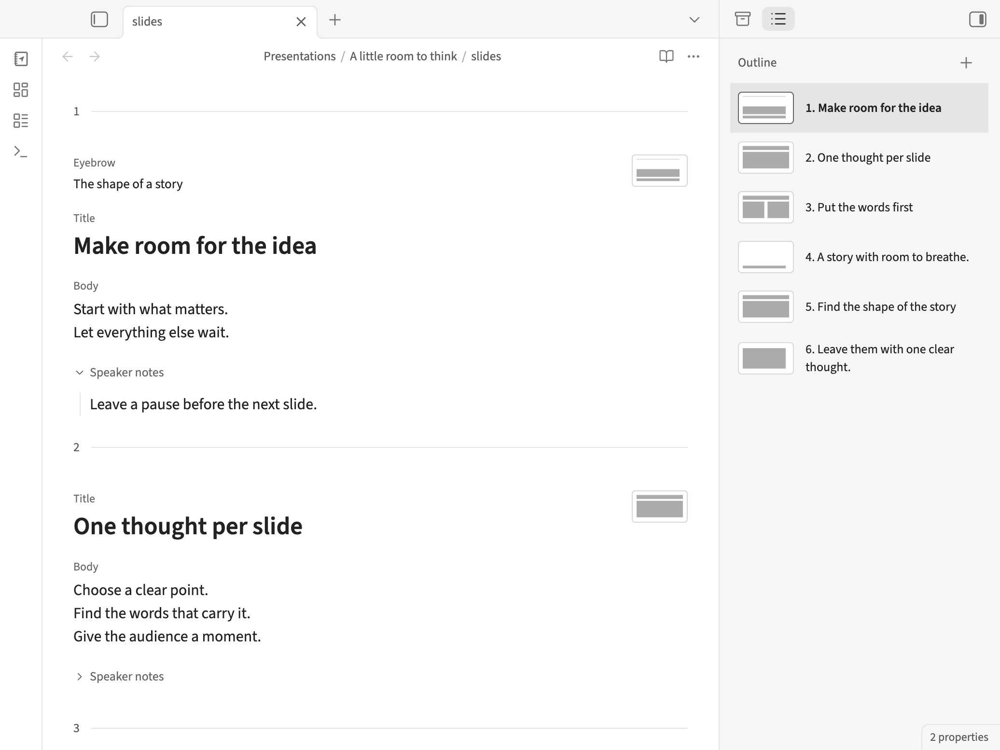
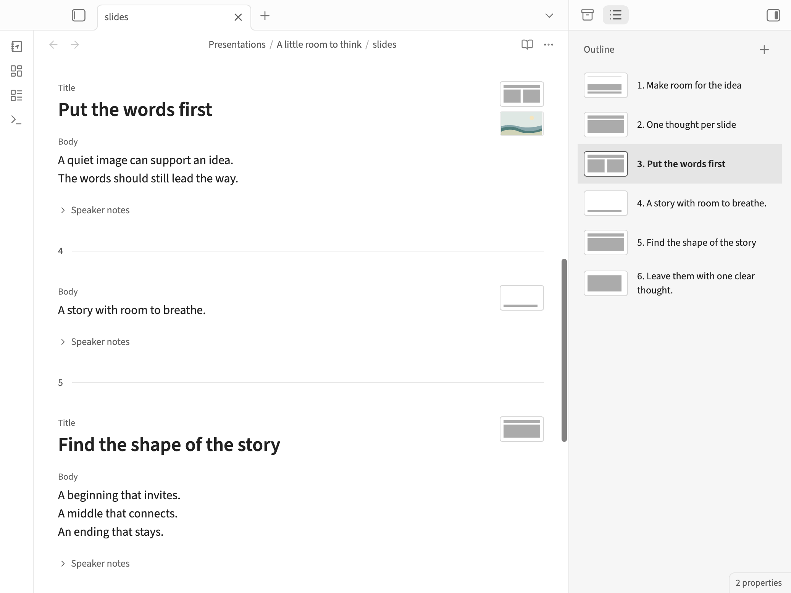
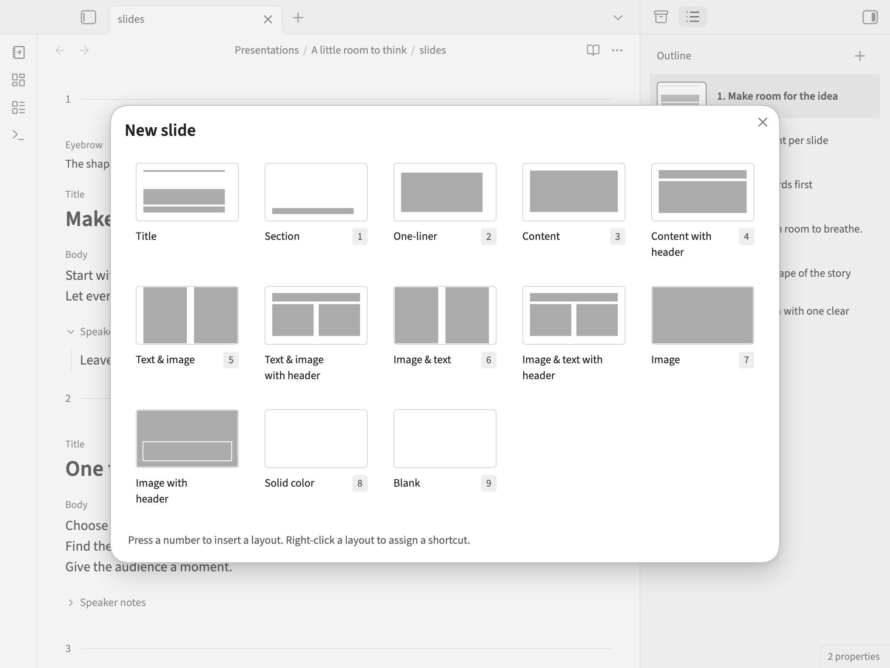

# MarkdownPoint for Obsidian

Write your slides where you keep your ideas.

MarkdownPoint turns a presentation into a calm, continuous draft in Obsidian. Write the words, collect speaker notes, and arrange the story in a small slide outline. Open the same presentation in [MarkdownPoint](https://markdownpoint.com) for visual finishing and presenting.



Your presentation stays in its own folder in your vault. Both apps work with the same files.

## Start a presentation

Requires **Obsidian 1.13 or newer** on desktop. The MarkdownPoint desktop app handles presentation design, playback and export.

After enabling the plugin, open Obsidian’s command palette and choose **MarkdownPoint: New presentation**.

1. Give the presentation a name and choose a folder in your vault.
2. Choose **Basic**, or a theme from an existing presentation in the vault.
3. Select **Create** and start writing.

The presentation opens in your current tab, ready for the first words. A theme supplies the slide layouts; you can concentrate on what each slide needs to say.

### Open an existing presentation

Place the complete presentation folder inside your vault, then open its `slides.md` file. Keep `presentation.mdpoint`, `themes/`, and any media folders beside it.

```text
My presentation/
├── slides.md
├── presentation.mdpoint
├── themes/
└── media/
```

`slides.md` holds the writing, notes and slide order. `presentation.mdpoint` holds the presentation data. Move or sync the complete folder to keep everything together.

## Write without styling

Each slide has a quiet numbered boundary. Its layout’s text areas appear in writing order: Title, Body, Eyebrow, or a custom field name.

An empty area shows a faint placeholder. Click it to write. Once it contains text, a small label appears above it so you can see which part of the slide you are editing. Placeholders and labels are never saved as presentation content.

Use **Live Preview** for the continuous draft. Slide markers are protected against accidental deletion; use the slide outline or context menu to move and remove slides. **Source mode** remains available for editing the raw Markdown.

One blank line between fields is organizational spacing and stays hidden in the draft. Additional blank lines remain visible, so intentional breathing room survives the round trip to MarkdownPoint.

### Speaker notes

Click anywhere on the **Speaker notes** row to expand it. An empty note shows **Notes**. Write reminders, transitions or a fuller script, then collapse the row when you want to concentrate on the slide.

Notes stay with their slide when you move, copy or delete it. Which notes are expanded is remembered on this device.

### Images beside the draft



Up to five assigned images appear below a slide’s small margin thumbnail. Background images come first, followed by named image areas and other assigned images.

Use these previews as context while writing. Add or adjust the images in MarkdownPoint; the writing stays in Obsidian. Turn previews off with **Settings → MarkdownPoint → Show slide images**.

## Shape the story

The **Outline** is its own sidebar tab, on the right by default. It works alongside Notebook Navigator and Obsidian’s other views.

Each row pairs a slide title with a small structural thumbnail. The filled areas show the arrangement of writing and media areas. These are guides to structure; the finished slide appearance belongs to MarkdownPoint.

Click a row to jump to its slide. Section names divide the outline without adding slide numbers. Skipped slides remain visible with a dash.

### Select and rearrange

- **Click** to select one slide and go to it.
- **Cmd-click** on Mac or **Ctrl-click** on Windows to toggle individual slides.
- **Shift-click** to select a range.
- **Shift+Up/Down** to extend a selection with the keyboard.
- **Cmd/Ctrl+A** to select every slide while the outline has focus.

Drag a selected row to move the selected slides together. The insertion line shows where they will land. Dropping on a section heading places them at the start of that section.

For precise movement, press **Cmd+Up/Down** on Mac or **Ctrl+Up/Down** on Windows while the outline has focus. Each move is undoable. Ordinary text-editing shortcuts keep their usual meaning in the editor.

### Copy, cut and delete slides

Right-click a slide in the outline, or right-click inside a slide in the editor, to choose **Cut slide**, **Copy slide**, **Paste slides** or **Delete slide**. The margin thumbnail opens the same slide actions.

In the outline, the menu acts on the selected group. In the editor, it acts on the clicked slide. Paste adds slides below the target slide.

Whole-slide actions carry the slide’s text, notes and presentation data together. In the outline, **Cmd/Ctrl+C**, **Cmd/Ctrl+X** and **Cmd/Ctrl+V** also work with slides; in the editor, they remain ordinary text shortcuts.

You can copy slides between presentations in the same vault when their theme definitions and artwork match. Required media is copied into the destination. For transfers between different themes or vaults, use MarkdownPoint’s desktop app.

Use Obsidian’s normal **Undo** and **Redo** to undo slide operations. The same shortcuts work while the outline has focus.

## Add a slide in a keystroke



Click **+** above the outline or run **MarkdownPoint: New slide**. Choose a layout to insert it below the current slide.

For layouts you use often, assign a digit:

1. Right-click a layout in the picker.
2. Choose **Shortcut**, then a number from **1–9**.
3. Next time you open the picker, press that number to insert the layout immediately.

The assigned number appears beneath the thumbnail, to the right of its name. Assigning a number to another layout moves that shortcut. Choose **None** to remove it.

## Continue in MarkdownPoint

Run **MarkdownPoint: Open in MarkdownPoint** to save the presentation and open its companion file with your installed desktop app.

Work on layout, imagery, animation and presentation there, then return to `slides.md` for another writing pass. Keep using the same folder. The operating system must associate `.mdpoint` files with MarkdownPoint for the command to open that app.

## Make the workspace yours

Use **Settings → MarkdownPoint → Sidebar** to place the outline on the left or right. Use Obsidian’s normal sidebar controls to show or hide that side.

For a keyboard-first workflow, assign your own hotkeys under **Settings → Hotkeys**:

| Command | What it does |
| --- | --- |
| New presentation | Create a presentation in the vault. |
| New slide | Open the layout picker. |
| Focus outline | Reveal and focus the slide outline. |
| Focus editor | Return to the writing area. |
| Move slides up | Move the outline selection up. |
| Move slides down | Move the outline selection down. |
| Open in MarkdownPoint | Save and open the presentation in the desktop app. |

The move commands act while the outline has focus. Tab and Obsidian’s tab-switching shortcuts retain their normal behavior.

Sidebar placement and expanded notes stay local to the device. Layout shortcuts and **Show slide images** follow your vault’s plugin-settings sync configuration. Obsidian manages sidebar visibility and width.

## Questions and troubleshooting

**Can I use Obsidian links and embeds?** Obsidian-specific syntax stays in the Markdown; the plugin does not convert wikilinks, note embeds or other plugins’ output into presentation content. Use standard Markdown links for portable links, and assign slide images in MarkdownPoint.

**The file looks like ordinary Markdown.** Open the presentation’s `slides.md` in Live Preview and check that its matching `presentation.mdpoint` is beside it. An unrelated note named `slides.md` is left alone. Extra presentation files or conflicted copies can make the pair ambiguous.

**The outline still shows another presentation.** It follows the active presentation and retains it while you work in an ordinary note. Activate the presentation’s editor to follow that one.

**Some images are missing.** Keep the complete presentation folder together. The editor shows up to five available assigned images; it does not add images to `slides.md`.

**A slide action asks me to try again.** The presentation changed while the action was being prepared. Let the latest changes appear, then repeat the action.

**Slide data could not be saved.** Keep the vault open and use **Retry** in the notice after resolving the file or storage problem. A recovery copy is kept on this device.

For questions or a reproducible problem, [open an issue](https://github.com/markdownpoint/markdownpoint-obsidian/issues).
